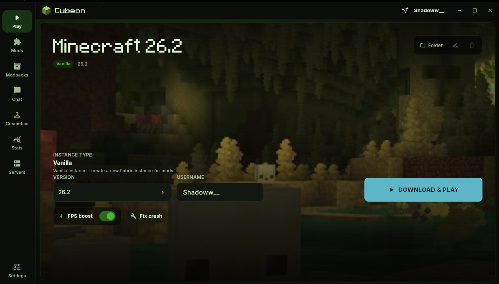
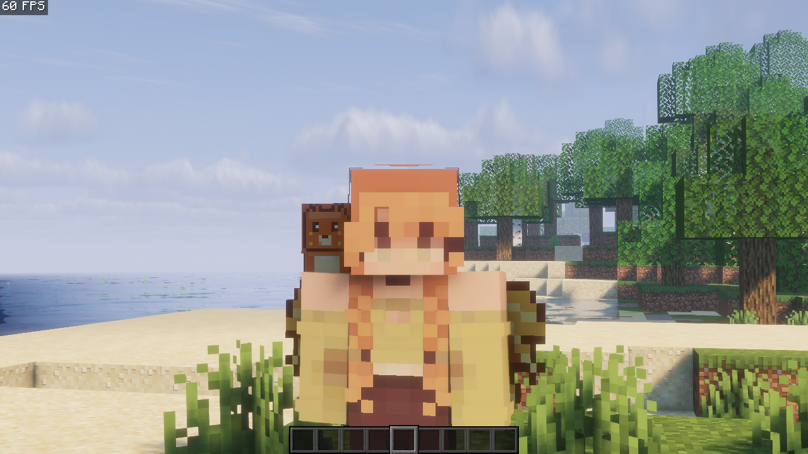

<h1 align="center">Cubeon</h1>

<p align="center">A free Minecraft Java Edition launcher.</p>

<p align="center">
  <a href="https://github.com/Shadow-457/Cubeon/releases"></a>
  
  
</p>

<p align="center">
  <a href="https://www.ylet.online/download">Download</a> ·
  <a href="docs/README.md">Documentation</a> ·
  <a href="CONTRIBUTING.md">Contributing</a> ·
  <a href="SECURITY.md">Security</a>
</p>

<p align="center">
  
</p>

Cubeon manages game installations, modded instances, cosmetics, and local
servers. It is built with Python and Flet for Linux, Windows, and macOS.

## Capabilities

- Install Minecraft releases and snapshots, and switch between saved instances.
- Manage Vanilla, Fabric, Quilt, Forge, and NeoForge configurations.
- Browse mods and modpacks, with instance-specific mods, resource packs, and shaders.
- Preview skins and capes in 3D, and manage a local cosmetics library.
- Track playtime and compare activity in the Stats tab.
- Manage local servers and share access through tunnels.

<p align="center">
  
</p>

Skins, shoulder companions, and back items, together in game.

Friends-enabled builds also include chat, presence, and in-game integration.
Feature availability can differ between development and public builds.

Cubeon uses local/offline player profiles, not Microsoft account sign-in.
Mods require a compatible loader; Vanilla supports resource packs but does
not run mods or shader packs on its own.

## Getting started

Get the build for your operating system from the
[download page](https://www.ylet.online/download).
See [User guide](docs/user-guide.md) for first launch, updates, and
troubleshooting. Python is not required for packaged builds.

## Run from source

Use Python 3.11, the version used by CI, and a desktop session.

```bash
git clone https://github.com/Shadow-457/Cubeon.git
cd Cubeon
python3 -m venv .venv
source .venv/bin/activate
python -m pip install -r requirements.txt
python main.py
```

On Windows, use `python` to create the environment and activate it with
`.\.venv\Scripts\Activate.ps1` in PowerShell.

The dependency file pins Flet to `0.86.x`. Use the virtual environment rather
than an unrelated system installation. Additional tools and platform notes
are in [Development setup](docs/development/setup.md).

## Development

Run these commands from the repository root, in the virtual environment:

```bash
python tools/test_mega_smoke.py
node worker/test-worker.mjs
```

The smoke gate checks Python source, contracts, and headless UI behavior.
Add `--suites` to run its registered regression suites. Node.js is only
needed for Worker tests; Java tooling is only needed for mod work.

- [Contribution guide](CONTRIBUTING.md)
- [Testing](docs/development/testing.md)
- [Architecture](docs/architecture/overview.md)
- [Builds and releases](docs/release/build.md)
- [Backend services](worker/README.md)

## Support and security

Report reproducible bugs through [GitHub Issues](https://github.com/Shadow-457/Cubeon/issues).
Include your Cubeon version, operating system, and steps to reproduce.
Use the [contribution guide](CONTRIBUTING.md) for feature proposals and pull requests.

Security vulnerabilities should be reported privately, not in public issues.
See the [security policy](SECURITY.md) for the reporting channel and required details.

## License

Cubeon is licensed under [Apache 2.0](LICENSE). See [NOTICE](NOTICE) for
attribution. Third-party components retain their own licenses.

Cubeon is not affiliated with Mojang or Microsoft. Minecraft is a trademark
of Mojang Studios.
