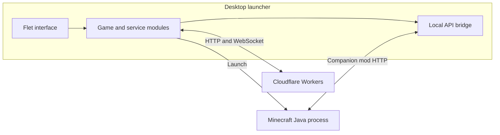

[Documentation](../README.md) / Architecture

# Architecture

Cubeon has a Python desktop launcher, a Fabric companion mod, and Cloudflare
Workers for online features. Minecraft runs as a separate Java process on
the user's computer.

The localhost bridge is used by the companion mod in Friends-enabled
configurations. Vanilla launches do not require that integration.

## Components

| Location | Responsibility |
| --- | --- |
| `main.py` | Application startup, window setup, navigation, and launch orchestration |
| `ui/` | Flet tab builders and dialogs |
| `cubeon/` | Launching, storage, downloads, services, and shared UI support |
| `launcher_core.py` | Compatibility facade for the underlying Python modules |
| `mod/` | Fabric client integration and Minecraft version brackets |
| `worker/` | Skins, invites, friends, downloads, and waitlist services |
| `packaging/` | Platform build and installer scripts |
| `tools/` | Regression checks, development harnesses, and release tools |

Most game and service logic can run without a Flet page. The `cubeon/`
package also contains UI helpers such as theme and motion; it is not a
strictly UI-free package.

## Desktop UI

`main.py` owns shared configuration and session state. Tab builders receive
the state and callbacks they need, returning a control tree and refresh
functions. Tabs are constructed lazily and retained for later navigation.

Downloads and service polling must not block UI handlers. Background tree
mutations use `thread_safe_ui.TREE_LOCK`, and repaint requests go through
`thread_safe_ui.refresh()` so they reach Flet's event loop safely.

Refreshing a label, unread count, or presence ring should not recreate its
parent row or retransmit unchanged artwork. Existing controls can be updated
in place. See [Launcher](launcher.md) for more detailed entry points.

## Game launch

The Play flow selects a Minecraft version and loader, installs missing
components, prepares the selected instance's content, and starts Java.

- `cubeon/versions.py` handles game versions and installation.
- `cubeon/mod_loaders.py` handles loader installation.
- `cubeon/launch.py` constructs the game command and starts the process.
- `cubeon/instances.py` reads installed-instance metadata.
- `cubeon/mods.py`, `modpacks.py`, and `content.py` manage installed content.

Selecting an installed instance must use that instance's loader, not leave
an unrelated loader toggle selected. Shared downloads can be reused, but
one instance's active mods or packs must not leak into another.

The storage and synchronization model is described in
[Content storage](content-storage.md) and [Mod management](mod-management.md).

## Identity and local state

The launcher's files live under `~/.cubeon_launcher/`; game files default
to `~/.cubeon_minecraft/`. `cubeon/paths.py` defines these locations.

An offline Minecraft username is not an authenticated Microsoft identity.
Cubeon's skin identity uses a public UUID and private capability token in
`auth_key.json`. The friends service has its own persisted identity and
relay-assigned ID. Do not treat display names as ownership credentials or
publish local identity files in diagnostic reports.

## Friends and the companion mod

`cubeon/friends_service.py` owns the process-level social service. The Chat
tab consumes that service directly; the in-game mod uses the authenticated
localhost bridge in `cubeon/local_api.py`. Both views operate on the same
launcher service rather than opening unrelated chat sessions.

The Worker handles presence and signaling. Direct-message encryption is
implemented in `cubeon/e2ee.py`. Voice audio is an optional dependency;
signaling support does not imply that audio is installed.

Friends can be disabled in a packaged build. `cubeon/features.py` resolves
the build marker and configuration override. See [Friends](friends.md),
[Networking](p2p.md), and the [protocol reference](../protocols/friends-api.md).

## Backend services

| Worker | Responsibility |
| --- | --- |
| `cubeon-skins.js` | Skin identity, uploads, cape delivery, and CustomSkinAPI reads |
| `cubeon-invites.js` | Invite-code creation and resolution |
| `cubeon-friends.js` | WebSocket presence, chat, groups, and call signaling |
| `cubeon-downloads.js` | Public download access to release assets |
| `cubeon-waitlist.js` | Website waitlist |

Worker source and Wrangler configuration live in `worker/`. Configuration
in the repository is not proof of a currently healthy deployment. Follow
the [Worker guide](../../worker/README.md) for deployment and verification.
